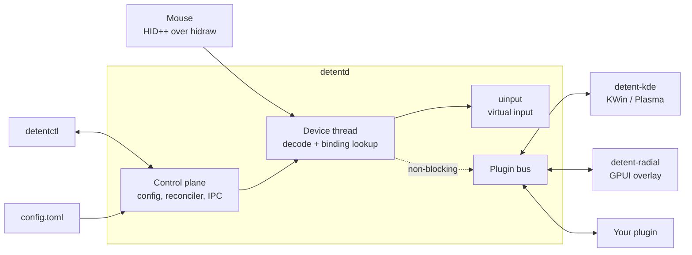

<div align="center">

<picture>
  <source media="(prefers-color-scheme: dark)" srcset=".design/assets/logo-lockup-dark.svg">
  <source media="(prefers-color-scheme: light)" srcset=".design/assets/logo-lockup-light.svg">
  
</picture>

**Take full control of your Logitech mouse. Fast, scriptable, and configurable by plain text or by AI.**

A userspace daemon written in Rust for Logitech HID++ mice, starting with the **MX Master 4**.
Remap buttons, chord them, turn swipes into desktop actions, edit every device setting, and
extend it with plugins such as a radial menu. Full support on Linux with KDE Plasma; macOS
and Windows are in preview.

[](https://github.com/Rfluid/detent/actions/workflows/ci.yml)
[](https://github.com/Rfluid/detent/actions/workflows/release.yml)


-lightgrey)
[](SPONSOR.md)

[Platforms](#platform-support) · [Install](#install) · [Configure with AI](#configure-your-mouse-with-ai) · [Capabilities](#capabilities) · [Plugins](#plugins) · [Contribute](#start-contributing) · [Docs](#documentation) · [FAQ](#faq) · [Sponsor](#sponsor)

<!-- TODO(orchestrator): demo GIF or screenshot. Record the radial menu opening on the
     thumb panel and a gesture swipe, save as docs/assets/demo.gif, then replace this
     comment with:
      -->

</div>

> [!NOTE]
> **Status: 0.1.0, the first public release.** The daemon, CLI, tray, KDE plugin and radial
> menu are implemented and verified on the author's machine (MX Master 4 over Bluetooth,
> Fedora, KDE Plasma 6, Wayland). Everything else in the table below is either a preview or
> an open issue waiting for someone with that OS. See the [roadmap](docs/product/roadmap.md).

## Platform support

| | Device settings | Remapping & gestures | Desktop actions plugin | Radial menu | Tray |
|---|---|---|---|---|---|
| **Linux / KDE Plasma 6** (Wayland) | ✅ | ✅ | ✅ `kde` | ✅ | ✅ |
| **Linux / GNOME** | ✅ | ✅ | [🚧][gnome] | [🚧][gnome] | [🚧][gnome] |
| **Linux / Hyprland & Sway** | ✅ | ✅ | [🚧][wlroots] | [🚧][wlroots] | ❔ |
| **Linux / X11 session** | ✅ | ✅ | [🚧][x11] | [🚧][x11] | ❔ |
| **macOS** | 🧪 preview | [🚧][macos] | [🚧][macos] | [🚧][macos] | [🚧][macos] |
| **Windows** | 🧪 preview | [🚧][windows] | [🚧][windows] | [🚧][windows] | [🚧][windows] |

✅ works · 🧪 preview: `detentctl` reads and changes DPI, SmartShift, wheel and haptics
settings directly on the mouse; no daemon yet, so changes aren't saved to a config
(`--persist`) or re-applied after a reconnect, and it hasn't been verified on real hardware
yet · 🚧 not yet: the link lists the open issues for it · ❔ untested (the tray is a
StatusNotifierItem; panels that host those should show it, reports welcome)

On Linux the daemon itself is desktop-agnostic (hidraw, evdev and uinput): settings,
remapping, chords and gestures don't depend on the desktop, though the author only runs them
on KDE. Outside KDE, bind gestures to `keys` or `exec` actions; the example config's swipes
call `kde.*` actions, which need the KDE plugin. Running something else and want it to be ✅?
See [Start contributing](#start-contributing).

[gnome]: https://github.com/Rfluid/detent/issues?q=is%3Aissue+is%3Aopen+label%3Aplatform%3Alinux-gnome
[wlroots]: https://github.com/Rfluid/detent/issues?q=is%3Aissue+is%3Aopen+label%3Aplatform%3Alinux-wlroots
[x11]: https://github.com/Rfluid/detent/issues?q=is%3Aissue+is%3Aopen+label%3Aplatform%3Alinux-x11
[macos]: https://github.com/Rfluid/detent/issues?q=is%3Aissue+is%3Aopen+label%3Aplatform%3Amacos
[windows]: https://github.com/Rfluid/detent/issues?q=is%3Aissue+is%3Aopen+label%3Aplatform%3Awindows
[help-wanted]: https://github.com/Rfluid/detent/issues?q=is%3Aissue+is%3Aopen+label%3A%22help+wanted%22
[good-first]: https://github.com/Rfluid/detent/issues?q=is%3Aissue+is%3Aopen+label%3A%22good+first+issue%22

## Why Detent

- **Low latency by design.** Mouse events go hidraw, decode, binding lookup, virtual input on one dedicated thread. No allocation, no locks, no async hop on the hot path. The design target is under 50 µs added at p99 (see [performance](docs/architecture/performance.md)); benchmarks gate regressions.
- **Everything visible, everything editable.** Detent keeps a live model of the device (what you asked for and what it reports) and re-applies your settings when the mouse wakes, reconnects or switches host.
- **Plugins that can do real things, without risk.** Plugins are separate processes on a local bus. A slow or crashed plugin loses messages, never your cursor. Input leases always expire.
- **A config you can read.** One documented TOML file, hot-reloaded on save. A broken file is rejected with a clear message and the previous config keeps working.
- **Leaves no trace.** Stop the service and the mouse behaves exactly as before.

## Configure your mouse with AI

Detent's configuration is a plain, documented TOML file plus a CLI that can validate it
(`detentctl config check`) and a set of specs. That is exactly what an AI coding agent
(Claude Code, Codex, and friends) is good at. Point one at this repo and describe what you want.

The repo ships agent context so the agent gets it right: [`AGENTS.md`](AGENTS.md) is the
entrypoint, [`.agent/`](.agent/README.md) holds skills and workflows, and
[`docs/specs/config.md`](docs/specs/config.md) is the full, example-backed reference for every key.

**Example prompt**

> Read `docs/specs/config.md` and `config/detent.example.toml`. In my
> `~/.config/detent/config.toml`, make the thumb button open the radial menu, and make
> holding the gesture button plus the left click take a region screenshot. Validate with
> `detentctl config check` before saving.

**Resulting change** (real keys from the [example config](config/detent.example.toml))

```diff
+[[bind]]
+when = "thumb.press"
+do = { action = "radial.open", menu = "main" }
+
+[[bind]]
+when = "gesture + left"          # chord: gesture must be pressed first
+do = { exec = "spectacle -r" }
```

Save, and it applies immediately with no restart. If the agent got a key wrong, `detentctl config check`
explains why and the running config is untouched, so experimenting is safe.

## Capabilities

Status reflects the [roadmap](docs/product/roadmap.md) and is for Linux; other platforms are
in the [table above](#platform-support). "Implemented" means built and verified by the agent
on the author's machine; the remaining hands-on checks are tracked there.

| Capability | What you get | Status |
|---|---|---|
| **Remap and chords** | Bind any divertable control, including chords like `gesture + left` and edges like `thumb.hold(400ms)`. Chorded clicks don't leak to the app | Implemented |
| **Gestures and layers** | Hold the gesture button and swipe; layers are active while a button is held (wheel, thumbwheel and clicks can all change meaning) | Implemented |
| **Actions** | Send keys, mouse buttons, run commands, call device actions (cycle DPI, haptic), or call plugin actions | Implemented |
| **See and edit device settings** | DPI, SmartShift, haptics, wheels, battery, Easy-Switch host via `detentctl settings get` / `set`, optionally `--persist`ed into your file | Implemented |
| **Survives reality** | Re-applies on sleep, Bluetooth reconnect and host switch; restores the mouse when stopped | Implemented (reconnect and sleep checks by hand pending) |
| **Hot reload** | Edit the file, it applies on save; invalid files are rejected | Implemented |
| **Per-app profiles** | Bindings that switch automatically by focused app (KDE) | Implemented |
| **KDE Plasma integration** | Overview, desktops, window actions, volume with the Plasma OSD | Implemented |
| **Radial menu** | A ring of actions around the cursor, modelled on Logitech's Actions Ring: hover and click, or hold and release, with haptic ticks, folders and per-app rings | Implemented (about 140 ms to appear; see [radial docs](docs/plugins/radial.md)) |
| **Third-party plugins** | Any language that can speak the [plugin bus](docs/specs/plugin-bus.md) | Implemented |
| **Tray icon** | Panel icon showing running / paused / stopped / no mouse / update; pause, reload, start the daemon from its menu ([tray docs](docs/user/tray.md)) | Implemented |
| **Timing triggers and sequences, settings GUI, RPM/COPR packaging, WASM filters** | | Planned (Phase 6) |

## Start contributing

Detent runs fully on one desktop today because its author has one desktop. Most of what's
missing is a port that needs someone who owns the hardware and the OS, and each port is
already written up as an issue.

1. **Pick an issue for your platform:** [`help wanted`][help-wanted] (or a
   [`good first issue`][good-first]). The [platform table](#platform-support) links each
   🚧 to its issues. Comment on the issue to claim it.
2. **Paste its one-shot prompt** into Claude Code (or a similar coding agent) running in a
   fresh clone. Every port issue ends with one. The agent reads [`AGENTS.md`](AGENTS.md),
   researches prior art, does the work, runs `just verify`, and opens a PR that closes the
   issue.
3. **Verify it on your machine.** You need the hardware and the OS: every OS API, D-Bus name
   and HID++ fact has to be checked on a real system and recorded in `.agent/memory/facts/`
   and the relevant spec. The PR includes the manual test from the issue, run by you.

Prefer to work by hand? Same issues, same rules. Details: [CONTRIBUTING.md](CONTRIBUTING.md).

## Install

**Stop other mouse tools first.** Solaar, logiops, JuhRadial or Logi Options+ divert the same
buttons and will fight Detent. Disable their autostart. On Linux, Detent detects the common
ones and warns in `detentctl status` and the log (`conflict_policy = "warn" | "refuse" | "ignore"`).

### Linux and macOS

```sh
curl -fsSL https://raw.githubusercontent.com/Rfluid/detent/main/install.sh | bash
```

### Windows (PowerShell)

```powershell
irm https://raw.githubusercontent.com/Rfluid/detent/main/scripts/install.ps1 | iex
```

The installers download the latest release for your OS and CPU, install it for your user,
and print where to go next, including how to contribute. They ask once whether you'd like to
sponsor the project; set `DETENT_NO_SPONSOR_PROMPT=1` to skip that question.

To pin a release, pass `--version v0.1.0` (`curl … | bash -s -- --version v0.1.0`) or set
`DETENT_VERSION=v0.1.0`; on Windows set `$env:DETENT_VERSION` before the `irm` line.
`--dry-run` shows what would be installed. Linux-only flags: `--no-udev`, `--no-service`, `--yes`.

### From a release archive

Download the archive for your platform from the [releases page](https://github.com/Rfluid/detent/releases):

| Platform | Archive | Contents |
|---|---|---|
| Linux x86_64, aarch64 | `.tar.gz` | everything: `detentd`, `detentctl`, `detent-kde`, `detent-radial`, `detent-tray`; run `./install.sh` inside |
| macOS Apple silicon, Intel | `.tar.gz` | `detentctl` (preview) |
| Windows x86_64 | `.zip` | `detentctl.exe` (preview) |

The macOS and Windows binaries are **not code-signed** in 0.1.0 (signing is an open issue):

- **macOS:** Gatekeeper blocks a downloaded unsigned binary. Clear the quarantine flag once:
  `xattr -d com.apple.quarantine ./detentctl`.
- **Windows:** SmartScreen may warn "Windows protected your PC". Choose **More info → Run
  anyway**.

### From source

```sh
git clone https://github.com/Rfluid/detent.git && cd detent
just install
```

Needs the Rust toolchain pinned in [`rust-toolchain.toml`](rust-toolchain.toml) (rustup picks
it up automatically) and [`just`](https://github.com/casey/just). On Linux the radial menu's
GPUI build needs Wayland, xkbcommon, fontconfig, Vulkan and ALSA development packages; on
Fedora: `sudo dnf install wayland-devel libxkbcommon-devel libxkbcommon-x11-devel
fontconfig-devel vulkan-loader-devel alsa-lib-devel openssl-devel`. See
[dev setup](docs/dev/setup.md).

### What the Linux installer does

- Installs the binaries (`detentd`, `detentctl`, `detent-kde`, `detent-radial`, `detent-tray`) to `~/.local/bin`.
- Installs and enables **systemd user services** for the daemon and the tray icon, so Detent runs from login.
- The **udev rule is the only step that needs `sudo`**. The installer prints the exact command and asks before running it. It grants your logged-in user access to the mouse's hidraw node, `/dev/uinput` and the mouse's evdev nodes, so Detent never runs as root.

Then check it sees your mouse and drop in the example config:

```sh
detentctl devices
detentctl status
mkdir -p ~/.config/detent
curl -fsSL https://raw.githubusercontent.com/Rfluid/detent/main/config/detent.example.toml \
  -o ~/.config/detent/config.toml
```

The full walkthrough, with a "try it" table and troubleshooting, is the [quickstart](docs/user/quickstart.md).
On macOS and Windows, `detentctl devices`, `settings list|get|set` (without `--persist`),
`debug features|controls` and `reset` work against the mouse directly; daemon commands say
they're not supported yet. There is no daemon or config file to set up.

**Uninstall:** `just uninstall`, or `./uninstall.sh` from the release archive (Linux and
macOS); on Windows, `uninstall.ps1` in `%LOCALAPPDATA%\Programs\Detent`. Your config is kept.

## CLI quick tour

```sh
detentctl status                      # daemon health: version, uptime, remapping, devices, plugins
detentctl disable / enable            # pause or resume remapping without stopping the daemon
detentctl devices battery             # per-device battery
detentctl settings list               # every settable path with its range
detentctl settings set dpi 1600 --persist
detentctl config check / reload / edit
detentctl events                      # live stream of actions, profile and link events
detentctl daemon restart / logs -f    # systemd user service and its journal
```

Every read command takes `--json`; exit codes follow sysexits. Shell completions
(`detentctl completions zsh`) and man pages (`just man`) come from the same command tree.
Full reference: [docs/user/cli.md](docs/user/cli.md).

## A taste of the config

```toml
[device."MX Master 4"]
dpi = 1600
smartshift = { mode = "ratchet", auto_threshold = 12 }

[[bind]]
when = "thumb.press"
do = { action = "radial.open", menu = "main" }

[layer.gesture]
hold = "gesture"
"swipe.up"    = { action = "kde.window.maximize" }
"swipe.left"  = { action = "kde.desktop.next" }
thumbwheel    = { action = "kde.volume" }

[profile.firefox]
match = { app = "firefox" }

[[profile.firefox.bind]]
when = "gesture + left"
do = { keys = "Ctrl+W" }
```

Full example: [`config/detent.example.toml`](config/detent.example.toml). Reference: [`docs/specs/config.md`](docs/specs/config.md).

## Plugins

Native plugins ship in this repo and use the same public bus as any third-party plugin.

| Plugin | What it does | Docs |
|---|---|---|
| **`kde`** | Connects gestures and wheels to KWin and Plasma (Overview, desktops, tiling, volume with OSD) and publishes the focused app so profiles can switch | [docs/plugins/kde.md](docs/plugins/kde.md) |
| **`radial`** | On-screen radial menu built with GPUI on a Wayland layer-shell overlay. Select by hover and click, or hold and release; haptic ticks, folders, per-app rings | [docs/plugins/radial.md](docs/plugins/radial.md) |

Write your own in any language: [docs/plugins/authoring.md](docs/plugins/authoring.md).

## Supported devices

| Device | Status |
|---|---|
| Logitech **MX Master 4** over Bluetooth (`046D:B042`) | Supported; developed and verified on Bluetooth |
| MX Master 4 through a Logi Bolt receiver (`046D:C548`) | In progress ([#5](https://github.com/Rfluid/detent/issues/5)): `detentctl` lists and reads it on Linux; daemon remapping not verified yet. Unifying receivers not supported |
| Other Logitech HID++ 2.0 mice (MX Master 3S, MX Anywhere 3S, ...) | Not yet ([open issues][transport]). The protocol layer is generic, but features and controls are only verified for the MX Master 4. See [device spec](docs/specs/devices/mx-master-4.md) |

Hardware facts are verified on the real device before code depends on them, so adding a
device needs someone who owns it.

[transport]: https://github.com/Rfluid/detent/issues?q=is%3Aissue+is%3Aopen+label%3Aarea%3Atransport

## Architecture



The data plane is a single dedicated thread. Config, device state reconciliation, IPC and
plugin supervision live on the control plane. Read [architecture overview](docs/architecture/overview.md)
and the [ADRs](docs/adr/) for the reasoning.

## What Detent is, and isn't

Detent is a **userspace daemon**, not a kernel driver. On Linux, the kernel's `hid-logitech-hidpp` stays loaded and handles basic input. Detent speaks Logitech's HID++ 2.0 over `/dev/hidraw*` to divert controls and change settings, and emits actions through `uinput`. It is in the same family as Solaar and logiops. Run only one of them at a time. On macOS and Windows, `detentctl` speaks the same HID++ through the OS's HID API; the daemon isn't ported yet.

## FAQ

<details>
<summary><b>How is this different from Solaar or logiops?</b></summary>

Same family, different emphasis: a performance-budgeted data plane, a live editable device model, a plugin bus (so a radial menu and KDE integration are plugins, not hacks), and a single documented TOML file designed to be edited by people and by AI agents. Detent currently targets one device well, while Solaar covers many. Prior art is studied in [docs/research/prior-art.md](docs/research/prior-art.md).
</details>

<details>
<summary><b>Do I need root?</b></summary>

No. On Linux, one `sudo` step installs a udev rule that grants your logged-in user device access, and the daemon runs as a systemd user service.
</details>

<details>
<summary><b>Will it work on GNOME, Hyprland, Sway or X11?</b></summary>

Settings, remapping, chords and gestures, yes: the daemon is desktop-agnostic (it uses hidraw, evdev and uinput). The `kde` and `radial` plugins are built for KDE Plasma 6 on Wayland; other desktops need their own plugin, and those are [open issues](#platform-support).
</details>

<details>
<summary><b>What about macOS and Windows?</b></summary>

A preview: `detentctl` reads and changes device settings (DPI, SmartShift, wheels, haptics) there, live only (no `--persist`), and it still needs its first run on real hardware. Remapping, gestures, the tray and the plugins need an input backend per OS; each is an open issue with a ready-made prompt for a coding agent. If you have a Mac or a Windows PC and the mouse, [that's where help counts most](#start-contributing).
</details>

<details>
<summary><b>The buttons do nothing after a crash.</b></summary>

Run `detentctl reset`. The service also does this automatically when it stops. More in the [troubleshooting table](docs/user/quickstart.md#5-troubleshooting).
</details>

<details>
<summary><b>Can a plugin freeze my mouse?</b></summary>

No. Delivery to plugins is a non-blocking send and leases expire. Hold left and right for 2 seconds as an escape chord to close the radial menu.
</details>

## Documentation

| | |
|---|---|
| Quickstart | [docs/user/quickstart.md](docs/user/quickstart.md) |
| Product spec and roadmap | [docs/product/spec.md](docs/product/spec.md), [docs/product/roadmap.md](docs/product/roadmap.md) |
| Architecture | [docs/architecture/overview.md](docs/architecture/overview.md) |
| Config reference | [docs/specs/config.md](docs/specs/config.md) |
| Plugin bus protocol | [docs/specs/plugin-bus.md](docs/specs/plugin-bus.md) |
| Writing a plugin | [docs/plugins/authoring.md](docs/plugins/authoring.md) |
| Decisions (ADRs) | [docs/adr/](docs/adr/) |
| Everything else | [docs/README.md](docs/README.md) |

## Contributing

Build and test with `just check-core`, `just test`, and `just verify` (lint plus tests, must pass before a change is done). Setup is in [docs/dev/setup.md](docs/dev/setup.md). Working with an AI agent? Start at [AGENTS.md](AGENTS.md). Design assets and rules live in [`.design/`](.design/README.md). The workflow, the hardware-verification rule and PR expectations are in [CONTRIBUTING.md](CONTRIBUTING.md); to pick something up, see [Start contributing](#start-contributing).

Please follow the [Code of Conduct](CODE_OF_CONDUCT.md). Security problems: report them privately ([SECURITY.md](SECURITY.md)).

## Sponsor

Detent is a hobby project, free and MIT-licensed. If it's useful to you, see
[SPONSOR.md](SPONSOR.md) for ways to support it, or sponsor on
[GitHub Sponsors](https://github.com/sponsors/Rfluid).

Besides the installer's question, the tray shows one notification a week after its first run,
at most once per session, until you pick **Don't ask again** or close it. Turn it off with
`nudge = false` under `[sponsor]` in `~/.config/detent/tray.toml`. The tray menu's
**Sponsor Detent…** and `detentctl sponsor` (add `--open` to open the page) show the links
whenever you want them.

## License

MIT. Detent builds on the GPUI snapshot crates (Apache-2.0).
